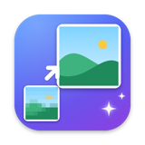
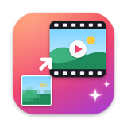
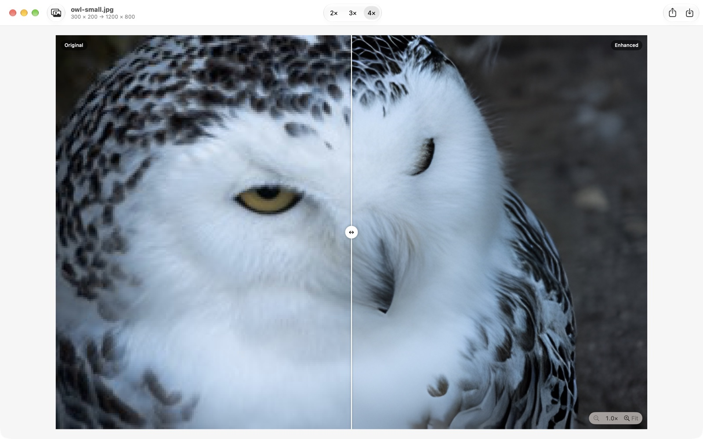
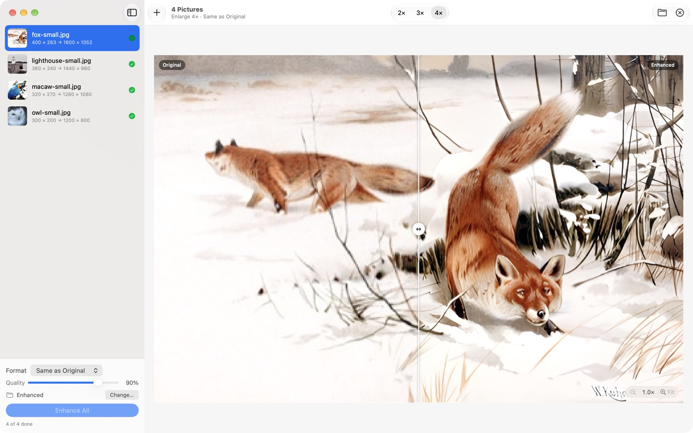
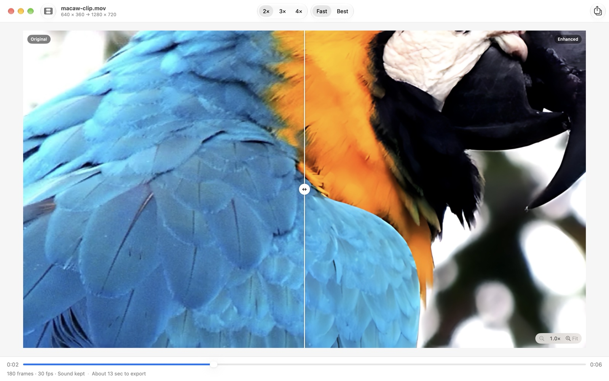

  
  

<h1 align="center">Enhance Picture & Enhance Video</h1>

Make small pictures and videos bigger and sharper with on-device AI. 
For Macs with Apple silicon.

  <a href="https://github.com/moreno001-create/Enhance-Download/releases/latest/download/Enhance-1.0.dmg"><b>⬇︎ Download Enhance 1.0 (DMG, 81 MB)</b></a>

---

Ordinary enlarging just stretches pixels, so pictures turn blocky and blurry. Enhance uses an AI model
trained to fill in the fine detail that should be there: feathers, fur, hair, leaves and fabric come out crisp
and natural instead of soft.

## Enhance Picture

- Enlarge pictures **2×, 3× or 4×**
- Drag the slider to **compare before and after**, and **pinch to zoom** up to 32×
- **Batch processing**: drop in many pictures or a whole folder and enhance them all at once
- Save as **PNG, JPEG, HEIC or TIFF** (with a quality setting), or keep each picture's original format
- Keeps the date, camera and location details and transparency

## Enhance Video

- Enlarge every frame **2×, 3× or 4×**, for example 480p to HD or HD to 4K
- **Fast** mode for most videos, **Best** mode for the most detail
- Preview any frame before exporting, and see how long the export will take
- **Batch processing** of many videos or a folder
- Export as **HEVC, H.264 or ProRes 422**, in **.mov or .mp4**; sound and rotation are kept

## Installing

1. Download **Enhance-1.0.dmg** and open it.
2. Drag **Enhance Picture** and **Enhance Video** into the **Applications** folder.
3. Open them from Applications or Launchpad. The first time, macOS asks
   *"Enhance Picture is an app downloaded from the internet. Are you sure you want to open it?"*. Click **Open**.

The apps are signed with a Developer ID and notarized by Apple, so macOS lets them open normally.

**Requirements:** a Mac with Apple silicon (M1 or later) and macOS 14 Sonoma or newer.

## Privacy

Everything runs on your Mac using its Neural Engine and graphics chip. Pictures and videos are never uploaded,
and the apps collect no data and don't connect to the internet.

## Credits

The AI models are [Real-ESRGAN](https://github.com/xinntao/Real-ESRGAN) by Xintao Wang (BSD-3-Clause licence,
shown in each app's About box). Screenshot photos are public domain / CC0 from Wikimedia Commons.

© 2026 Anthony Moreno
